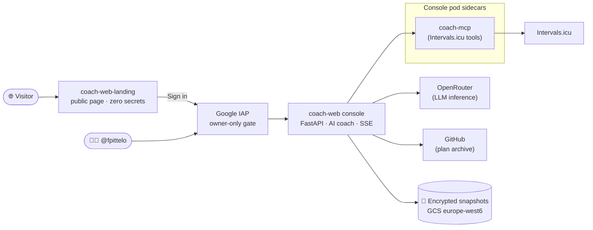

# 🚴‍♂️ Coach Web — Your Personal Endurance Cockpit

> **Your coach talks. Your watts listen. Your body thanks you.**
>
> Coach Web is a personal AI coaching cockpit: it reads your live Intervals.icu data,
> coaches you in plain language, plans workouts with explicit wattage, and remembers
> your season across sessions — private by design, hosted in Switzerland.

---

## 🎯 What is Coach Web?

- **💬 Talk to your coach** — a conversational AI coach grounded in your live readiness: FTP, resting HR, HRV, sleep, and fitness/fatigue/form (CTL · ATL · TSB).
- **✅ Approve, don't hope** — season and weekly plans still land as review cards with explicit watts. Single calendar events are different: tell the coach to create, move, rewrite or delete one — including explicit-Watt ERG `workout_doc` steps — and it edits your Intervals.icu calendar directly, behind server-side mutation, verification and erasure guards ([MADR-0034](docs/adr/0034-direct-conversational-calendar-writes.md)).
- **🧠 It remembers you** — debriefs, standing preferences, and season objectives persist in encrypted memory that survives restarts and cold starts.
- **🇨🇭 Private by design** — single-athlete, zero trackers, all data encrypted and resident in the Swiss-adjacent Zürich region (`europe-west6`).

---

## 🏛️ Architecture at a Glance

**Two surfaces. One zero-trust boundary. Zero secrets where they don't belong.**

- **`coach-web-landing`** — the public front door: a static, secret-free page anyone can read.
- **`coach-web`** — the actual cockpit: locked behind Google IAP + owner allowlist; only you get in.

---

## ⚙️ How It Runs

- **Production** — Google Cloud Run in `europe-west6`, always-on scale-to-zero: a public landing service and an IAP-gated console service, deployed together on every release.
- **Releases** — semantic `vX.Y.Z` tags cut from `main` and deployed as immutable, digest-pinned container images.
- **Development** — plain `uv` locally, or isolated loopback-only Docker Compose lanes (`dev` / `qa` / `prod`) on your workstation. See the [Admin Guide](docs/admin_guide.md).

---

## 📊 What You'll See

| Metric | What it tells you |
|:---|:---|
| **FTP** | Your cycling power baseline (watts) — the anchor for every interval |
| **Resting HR** | Recovery quality — low = recovered, high = accumulated fatigue |
| **HRV (rMSSD)** | Nervous system readiness — higher = more parasympathetic = ready to train |
| **Sleep** | How much repair your body got last night |
| **CTL (Fitness)** | Your 42-day aerobic engine size — the bigger, the stronger |
| **ATL (Fatigue)** | Your 7-day acute load — the higher, the more tired you are right now |
| **TSB (Form)** | CTL minus ATL — negative = building, positive = tapering/peaking |

---

## 📖 Documentation

| Document | Audience |
|:---|:---|
| [User Guide](docs/user_guide.md) | @fpittelo — how to use the cockpit |
| [Admin Guide](docs/admin_guide.md) | @devops — deployment, Docker lanes, environment |
| [Specifications](docs/specifications.md) | @architect — technical specs & data flow |
| [Architecture (arc42)](docs/architecture/arc42/01-context-and-building-blocks.md) | @architect — context, building blocks, ADRs |
| [Security](docs/security.md) | @cyber-security — threat model & controls |
| [Accessibility](docs/accessibility.md) | UI accessibility conformance |
| [E2E Checklist](docs/e2e-checklist.md) | Release pre-flight verification |

---

## 🔒 Security & Privacy

- **Zero-trust edge** — the console is reachable only through Google IAP with an owner-email allowlist, plus in-app OIDC as defense-in-depth.
- **Encrypted, resident data** — coaching memory is Fernet-encrypted at rest and stored exclusively in the Zürich region (`europe-west6`).
- **No keys in the browser** — API credentials live only server-side, in sidecar containers; the web app never touches them.
- **Swiss nLPD / FADP aligned** — single-athlete scope, bounded retention, self-service purge; a public Disclaimer and Privacy Policy ship with the app (`/disclaimer`, `/privacy`).

---

## 🧱 Tech Stack

| Layer | Technology |
|:---|:---|
| **Backend** | Python 3.12 · FastAPI · Pydantic v2 |
| **Frontend** | Alpine.js + hand-written CSS — zero build step, zero CDN |
| **Streaming** | Server-Sent Events |
| **AI** | OpenRouter tool-calling agent loop · MCP sidecars |
| **Storage** | SQLite (WAL) with Fernet field encryption · GCS snapshots |
| **Containers** | Multi-stage OCI images, non-root, digest-pinned deploys |
| **CI/CD** | GitHub Actions — zero-warning gate, secret & dependency scans |

---

## 🌳 Branching & Releases

Coach Web follows the HOME trunk+tag lifecycle: `main` is the single persistent trunk, features land via squash-merged PRs, and every release is a semantic `vX.Y.Z` tag + GitHub Release published under one explicit product-owner approval — with 100% clean CI required for every merge.

---

## 📄 License

**GNU General Public License v3.0 or later (GPL-3.0-or-later)** — see [LICENSE.md](LICENSE.md).

Same license as the Coach MCP server. Open source, copyleft, built with love in Switzerland. 🇨🇭

---

## 🙌 Acknowledgements

- **[Intervals.icu](https://intervals.icu)** — the best endurance analytics platform on the planet
- **[Model Context Protocol](https://modelcontextprotocol.io)** — Anthropic's protocol for LLM-tool integration
- **[FastAPI](https://fastapi.tiangolo.com)** — high-performance async Python web framework
- **[HOME SCRUM Team](https://github.com/fpittelo)** — @architect, @scrum-master, @developer, @devops, @cyber-security, @code-reviewer

---

> _Built by the HOME SCRUM Team for @fpittelo. Because watts don't lie, and neither should your dashboard._
