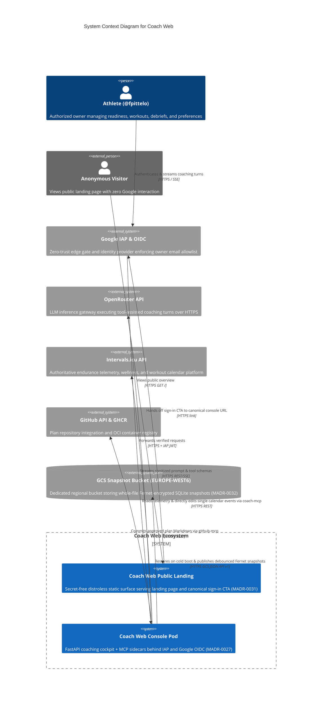
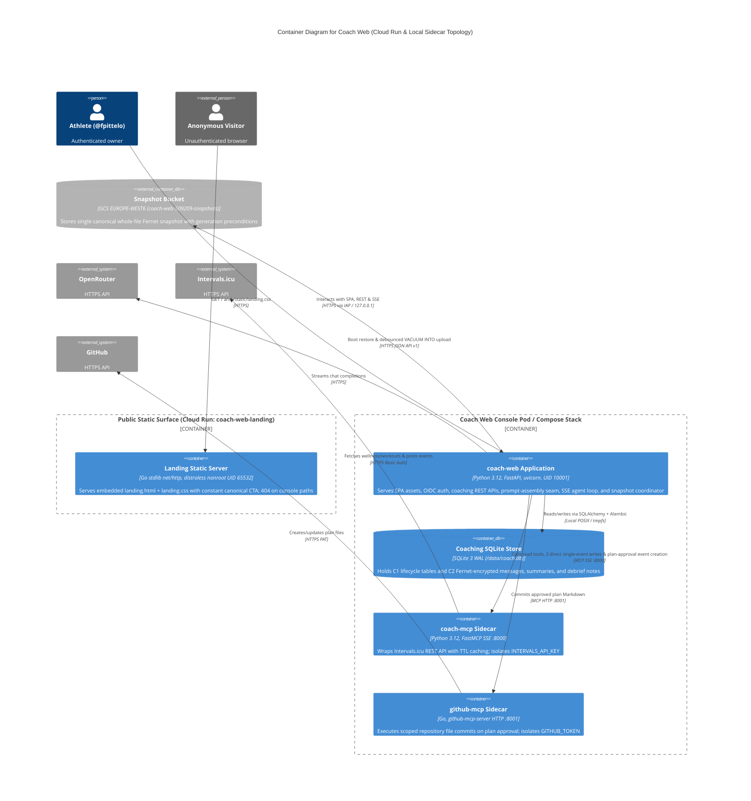

# 1. Context & Building Blocks — Coach Web

**Status:** active (consolidated #369)

---

## 1. Introduction & Goals

### 1.1 Requirements Overview

**Coach Web** (`fpittelo/coach-web`) is the personal AI endurance and functional-strength coaching cockpit for **Frederic Pitteloud (`@fpittelo`)**. It turns live biometric, wellness, and workout telemetry from **Intervals.icu** (exposed via the companion `coach-mcp` FastMCP server) into an interactive conversational coaching workspace with human-in-the-loop workout approval gates, structured post-session debriefs, season periodization, and encrypted longitudinal memory.

Core capabilities delivered by the system:

- **Conversational AI Coach over SSE (`POST /api/agent/stream`):** streams typed Server-Sent Events from an OpenRouter-backed tool-calling agent assembled through a single deterministic system-prompt seam (`assemble_system_prompt`).
- **Human-in-the-loop plan approval (`POST /api/plan/approve`):** renders structured cycling and Kettlebell workout proposals with explicit wattage (HOME Rule #6) that require explicit athlete approval before writing events to Intervals.icu.
- **Longitudinal coaching lifecycle & memory:** server-owned Fernet-encrypted conversation threads and rolling summaries ([MADR-0025](../../adr/0025-conversation-memory-model-retention-and-injection-contract.md)), structured post-session debriefs, macro-objectives, periodization phases, microcycle plan drafts ([MADR-0008](../../adr/0008-persistence-data-classification.md)), cross-thread longitudinal briefs, and owner orientation / standing athlete preferences ([MADR-0026](../../adr/0026-admin-orientation-and-agent-settings-prompt-precedence-and-sanitizer-contract.md), [MADR-0032](../../adr/0032-durable-longitudinal-memory-snapshot-store.md)).
- **Dual-surface production posture:** an IAP + Google OIDC zero-trust console on GCP Cloud Run (`europe-west6`, [MADR-0027](../../adr/0027-cloud-run-production-operating-model.md)) paired with an isolated, secret-free public static landing surface ([MADR-0031](../../adr/0031-public-landing-surface-with-iap-unchanged.md)) and local workstation Docker Compose lanes (`dev` / `qa` / `prod`, [MADR-0024](../../adr/0024-always-on-prod-lane-release-verified-auto-update.md)).

### 1.2 Quality Goals

| Priority | Quality Goal | Why It Matters |
| :--- | :--- | :--- |
| 1 | **Confidentiality & Swiss nLPD Compliance** | Biometric, readiness, qualitative debrief, and conversation records are C2 sensitive personal data under Swiss nLPD/FADP; they require Zürich (`europe-west6`) or local residency, Fernet encryption at rest, bounded retention, and fail-closed edge authentication. |
| 2 | **Prompt-Injection & Tool-Boundary Safety** | Untrusted or athlete-authored text (threads, debrief notes, orientation, preferences, external tool payloads) must never override immutable tool-gating rules or trigger unapproved write mutations. |
| 3 | **Durable, Anti-Clobber State Across Scale-to-Zero** | Cloud Run scales idle instances to zero; cold starts must deterministically restore encrypted SQLite state without ever overwriting newer remote state with an empty database ([MADR-0032](../../adr/0032-durable-longitudinal-memory-snapshot-store.md) C6). |
| 4 | **Simplicity & Zero-CDN Operational Discipline (KIS/YAGNI)** | Single-athlete (`n=1`) scope requires zero frontend build toolchains, zero third-party CDNs/trackers, minimal dependencies, and a strict zero-warning CI/CD pipeline. |

### 1.3 Stakeholders & Their Goals

| Stakeholder | Role | Goal |
| :--- | :--- | :--- |
| **`@fpittelo`** | Athlete & Product Owner | High-signal daily readiness coaching, structured wattage workouts on Intervals.icu, durable cross-session continuity, and strict personal data sovereignty. |
| **`@architect`** | Solution Architect | Cohesive `arc42` + MADR governance, ArchiMate 3.x alignment, minimal-diff KIS/YAGNI specifications. |
| **`@cyber-security`** | Security Specialist | STRIDE threat modeling, least-privilege GCP IAM custom roles, Fernet cryptographic envelopes, and fail-closed CI/deploy gates. |
| **`@developer` / `@devops`** | Engineering & Delivery | Strict TDD Python 3.12 delivery (`>80%` coverage, `mypy --strict`, `0` warnings) and reproducible digest-pinned OCI/Cloud Run operations. |

---

## 2. Architecture Constraints

| Constraint | Source | Architectural Impact |
| :--- | :--- | :--- |
| **Swiss nLPD / FADP & `europe-west6` Residency** | `home-governance` §2, [MADR-0008](../../adr/0008-persistence-data-classification.md), [MADR-0032](../../adr/0032-durable-longitudinal-memory-snapshot-store.md) | Cloud workloads and GCS snapshot storage are pinned exclusively to regional `EUROPE-WEST6` (Zürich); C2 columns and whole-file snapshots are Fernet-encrypted with `DATA_ENCRYPTION_KEY`; retention is bounded (`90d` messages / `365d` inactive threads). |
| **Single Persistent Trunk (`main`) + Semantic Tags** | `home-governance` §5 (MADR-0017) | All feature branches squash-merge into `main`; releases are `vX.Y.Z` tags cut from `main` after one explicit `@fpittelo` approval; `cloud-run-deploy.yaml` refuses mutable release-class tags (`prod`, `latest`, `v*`) and deploys resolved `@sha256` digests only. |
| **Zero-Warning Quality & Security Gate** | `home-governance` §5 Rule 4 & §8 | Every PR passes `ruff`, `black`, `isort`, `mypy --strict`, `pytest -W error --cov-fail-under=80`, `gitleaks`, `pip-audit --strict`, `trivy` (both `coach-web` and `coach-web-landing` images), and `Compose Lane Validation`. |
| **Zero Frontend Build / Zero External CDN** | Pre-MADR ADR-006 (`03` §5) | UI ships vendored Alpine.js, `marked`, `DOMPurify`, self-hosted Inter WOFF2, and hand-written CSS under strict `Content-Security-Policy` (`'self'`, zero third-party asset hosts). |
| **Single-Athlete (`n=1`) KIS / YAGNI Scope** | `home-governance` §9 (`kis-yagni`) | Single-writer Cloud Run ceiling (`maxScale=1`), SQLite WAL on local POSIX/tmpfs rather than managed RDBMS or vector RAG infrastructure, no multi-tenant account subsystem. |

---

## 3. System Context & Scope

### 3.1 Business & System Context (`C4Context`)

### 3.2 Technical Context

| Channel | Protocol & Auth | Security & Boundary Notes |
| :--- | :--- | :--- |
| **Visitor → `coach-web-landing`** | HTTPS (`GET` / `HEAD` on `/` and `/static/landing.css`) | Cloud Run `roles/run.invoker = allUsers`, `iap-enabled` absent, zero cookies, zero env vars, constant CTA to canonical console URL ([MADR-0031](../../adr/0031-public-landing-surface-with-iap-unchanged.md)). |
| **Athlete → `coach-web` (Cloud Run)** | HTTPS + SSE via Google Front End + IAP | Direct-on-service IAP (`roles/run.invoker` held exclusively by IAP service agent) + in-app Google OIDC session cookie (`cw_session`, `HttpOnly`, `Secure`, `SameSite=Lax`, host-only) restricted to `AUTH_WHITELIST_EMAILS` ([MADR-0027](../../adr/0027-cloud-run-production-operating-model.md)). |
| **Athlete → `coach-web` (Local Lanes)** | HTTP on `127.0.0.1:{8100,8200,8000}` | Host loopback binding is the primary boundary; local `prod` enables Google OIDC as defense-in-depth (pre-MADR ADR-007, [MADR-0024](../../adr/0024-always-on-prod-lane-release-verified-auto-update.md)). |
| **`coach-web` → `coach-mcp` Sidecar** | MCP over HTTP SSE (`:8000/sse`, pod-local / Compose internal network) | `coach-web` never holds `INTERVALS_API_KEY`; the agent loop enforces `COACH_MCP_ALLOWED_TOOLS` (19 reads + exactly 3 single-event writes, [MADR-0034](../../adr/0034-direct-conversational-calendar-writes.md)). The 3 direct writes are bounded pre-hub by the C1 mutation budget, C2 verified-event gate, C3 self `athlete_id` pin and C4 preservation guard; all other write tools execute only on explicit `POST /api/plan/approve`. |
| **`coach-web` → `github-mcp` Sidecar** | MCP over HTTP (`:8001/`, pod-local / Compose internal network) | Scoped to `GITHUB_TOKEN` inside `github-mcp` for `POST /api/plan/approve` Markdown commits (scheduled for retirement in Epic `#440`). |
| **`coach-web` → OpenRouter** | HTTPS (`https://openrouter.ai/api/v1`) + `OPENROUTER_API_KEY` | Transmits the sanitized coaching prompt, server-owned thread window, and MCP tool outputs (reads plus the scoped single-event write results); explicit owner UI disclosure governed by [MADR-0026](../../adr/0026-admin-orientation-and-agent-settings-prompt-precedence-and-sanitizer-contract.md) C4. |
| **`coach-web` → GCS Snapshot Store** | HTTPS (`https://storage.googleapis.com`, JSON API v1) + metadata OAuth token | Dedicated `coach-web-509209-snapshots` bucket (`EUROPE-WEST6`, UBLA, PAP `enforced`), bucket-scoped `coachWebSnapshotObjectActor` custom role, `ifGenerationMatch` preconditions, whole-file `Fernet` ciphertext ([MADR-0032](../../adr/0032-durable-longitudinal-memory-snapshot-store.md)). |

### 3.3 Scope Decisions

- **In scope:** interactive readiness & training chat, structured workout proposal cards with explicit human approval, direct conversational create/update/delete of single Intervals.icu calendar events with explicit-Watt ERG `workout_doc` (MADR-0034), encrypted debriefs/threads/summaries, macro-objectives/periodization/microcycle drafts, owner orientation & standing preferences, Cloud Run scale-to-zero durability, and public static entry page.
- **Out of scope:** unapproved Intervals.icu writes beyond the three scoped single-event tools (batch/activity/wellness family), multi-user/multi-tenant accounts, vector databases or embedding RAG pipelines, client-side API keys, and third-party analytics/trackers.

---

## 4. Solution Strategy

| Concern | Chosen Approach | Governing Record |
| :--- | :--- | :--- |
| **Application & UI Stack** | Async Python 3.12 + FastAPI + `sse-starlette` serving static Alpine.js + hand-written v0.7 CSS tokens; `DOMPurify.sanitize(marked.parse(...))` on assistant bubbles only (`x-text` everywhere else). | Pre-MADR ADR-006 (`03` §5), [MADR-0011](../../adr/0011-quick-reply-suggestions.md) |
| **Data Classification & Encryption** | Tiered SQLite (WAL) schema managed by Alembic (`render_as_batch=True`): C1 structural metadata in typed columns, C2 qualitative/conversation/summary payloads encrypted at the application layer with `Fernet(DATA_ENCRYPTION_KEY)`. | [MADR-0008](../../adr/0008-persistence-data-classification.md), [MADR-0025](../../adr/0025-conversation-memory-model-retention-and-injection-contract.md) |
| **Durable Cloud Run Persistence** | Keep SQLite WAL on fast in-memory `/data` `tmpfs` (no GCS FUSE); rehydrate on cold start (`decrypt → integrity_check → staged alembic upgrade head → atomic os.replace`) and publish 60 s debounced + `SIGTERM` `VACUUM INTO` whole-file Fernet snapshots to `EUROPE-WEST6` GCS. | [MADR-0032](../../adr/0032-durable-longitudinal-memory-snapshot-store.md) |
| **Prompt Assembly & Injection Defense** | Single `assemble_system_prompt` seam with fixed precedence (`core → orientation → preferences → digests → thread memory → cross-thread brief → REASSERT_CLAUSE LAST`), two-site `sanitize_untrusted_text`, and `\| `-prefixed data fences. | [MADR-0026](../../adr/0026-admin-orientation-and-agent-settings-prompt-precedence-and-sanitizer-contract.md), [MADR-0032](../../adr/0032-durable-longitudinal-memory-snapshot-store.md) |
| **Zero-Trust Edge & Public Entry Split** | Keep Cloud Run console behind direct-on-service IAP + OIDC allowlist (`maxScale=1`, dedicated runtime/deploy SA split, resource-scoped `run.admin` and `iap.admin`); serve public landing from a separate zero-role distroless Go static service. | [MADR-0027](../../adr/0027-cloud-run-production-operating-model.md) (Am. 0001–0005), [MADR-0031](../../adr/0031-public-landing-surface-with-iap-unchanged.md) |
| **Local Workstation Continuity** | Three loopback-only Compose lanes (`dev`/`qa`/`prod`) plus `systemd` user timer running release-verified digest auto-updates every 5 minutes. | Pre-MADR ADR-007 (`03` §5), [MADR-0024](../../adr/0024-always-on-prod-lane-release-verified-auto-update.md) |

---

## 5. Building Block View

### 5.1 Whitebox Overall System (`C4Container`)

### 5.2 Level 2 — `coach-web` Internal Building Blocks

| Module / Package | Responsibility | Key Interfaces & Contracts |
| :--- | :--- | :--- |
| `src/coach_web/app.py` | FastAPI factory, lifespan orchestration (`MCPClientHub`, `SnapshotCoordinator`, opportunistic retention sweep), static shell, and REST/SSE endpoints. | `create_app()`, `POST /api/agent/stream`, `POST /api/plan/approve`, `/api/admin/agent-settings`, `/health` |
| `src/coach_web/auth/` | Google OIDC login/callback/logout router, signed session cookies, canonical-host redirect middleware, and `AUTH_WHITELIST_EMAILS` gate. | `/auth/login`, `/auth/callback`, `/auth/logout`, `AuthMiddleware` |
| `src/coach_web/agent.py` | `CoachAgent` OpenRouter tool-calling loop, `COACH_MCP_ALLOWED_TOOLS` enforcement, pre-hub event-write guards (C1 budget, C2 verified `event_id`, C3 self `athlete_id`, C4 preservation) and metadata-only write logs, `sanitize_untrusted_text`, and the single `assemble_system_prompt` seam (`REASSERT_CLAUSE` structurally LAST). | `CoachAgent.stream()`, `assemble_system_prompt()`, `sanitize_untrusted_text()` ([MADR-0034](../../adr/0034-direct-conversational-calendar-writes.md)) |
| `src/coach_web/agent_settings.py` | Singleton C1 owner orientation, autonomy/verbosity enums, and standing athlete preferences (`environment_preference`, `standing_preferences` ≤1000 chars) with two-site sanitization and metadata-only audit logs. | `get_agent_settings()`, `save_agent_settings()`, `reset_agent_settings()` ([MADR-0026](../../adr/0026-admin-orientation-and-agent-settings-prompt-precedence-and-sanitizer-contract.md), [MADR-0032](../../adr/0032-durable-longitudinal-memory-snapshot-store.md)) |
| `src/coach_web/conversation.py` · `conversation_context.py` · `conversation_api.py` | Per-athlete Fernet-encrypted conversation threads, 20-message sliding window, deterministic rolling summary (`summary_encrypted`), and `build_cross_thread_brief` (recent prior summaries, 90d debrief facts/notes, open actions; 8000-char cap). | `GET /api/conversation`, `POST /api/conversation/{reset,purge}`, `build_cross_thread_brief()` ([MADR-0025](../../adr/0025-conversation-memory-model-retention-and-injection-contract.md), [MADR-0032](../../adr/0032-durable-longitudinal-memory-snapshot-store.md) C7) |
| `src/coach_web/snapshot.py` | Keyless HTTPS GCS JSON API v1 snapshot client, fail-closed `boot-restore` CLI (staged migration before atomic swap), `0700`/`0600` `VACUUM INTO` Fernet builder, `SnapshotCoordinator` (60 s debounce + `SIGTERM` flush + synchronous purge overwrite). | `python -m coach_web.snapshot boot-restore`, `SnapshotCoordinator.notify_dirty()`, `publish_now()` ([MADR-0032](../../adr/0032-durable-longitudinal-memory-snapshot-store.md) C1–C6) |
| `src/coach_web/debrief.py` · `objectives.py` · `periodization.py` · `microcycle.py` · `analysis.py` · `briefing.py` · `mirror.py` | Coaching domain stores and prompt digest builders: Fernet-encrypted session debriefs, season objectives, training phases, weekly plan drafts, plan-vs-actual divergence digests, and proactive session greetings. | `/api/debriefs`, `/api/objectives`, `/api/periodization`, `/api/microcycle` ([MADR-0008](../../adr/0008-persistence-data-classification.md), [MADR-0010](../../adr/0010-proactivity-model.md)) |
| `src/coach_web/plan_approval.py` · `suggestions.py` | Independent execution of approved `PlanProposal` payloads (`intervals_create_event` + GitHub Markdown commit) and server-owned outcome-mapped quick-reply pills on terminal `done` SSE frames. | `approve_plan()`, `SuggestionsPayload` ([MADR-0011](../../adr/0011-quick-reply-suggestions.md)) |
| `src/coach_web/mcp_hub.py` · `mcp_client.py` | Concurrent MCP client lifecycle managing `coach-mcp` (SSE) and `github-mcp` (HTTP) sessions with graceful degradation when a sidecar is unreachable; bounded local-only `#/$defs` `$ref` resolution gates `response_format` injection (C5). | `MCPClientHub` ([MADR-0034](../../adr/0034-direct-conversational-calendar-writes.md)) |
| `src/coach_web/db.py` · `alembic/` · `maintenance.py` | SQLite WAL engine factory (`PRAGMA foreign_keys=ON`, `synchronous=NORMAL`), packaged Alembic migrations (`0001`–`0009`), and 90d/365d retention purge CLI/hooks. | `create_sqlite_engine()`, `purge_expired()` |
| `src/coach_web/static/` | Single-page Alpine.js cockpit (`index.html`, `app.js`, `styles.css`), public landing source (`landing.html`, `landing.css`), self-hosted Inter fonts, and vendored `marked`/`DOMPurify`. | Served at `/` and `/static/*` |
| `landing/server.go` · `Dockerfile.landing` | Standalone stdlib Go HTTP server embedding build-time CTA-rewritten `landing.html` + `landing.css` into a shell-free distroless container. | `coach-web-landing` Cloud Run service ([MADR-0031](../../adr/0031-public-landing-surface-with-iap-unchanged.md)) |
| `scripts/prod_update.py` · `deploy/systemd/` | Local workstation `systemd` user timer/service polling GitHub Releases every 5 minutes, verifying ancestry + `deep-validation: success` + GHCR digest before rolling local `prod`. | `coach-web.service`, `coach-web-update.{service,timer}` ([MADR-0024](../../adr/0024-always-on-prod-lane-release-verified-auto-update.md)) |

### 5.3 ArchiMate 3.x Metamodel Alignment (`home-governance` §4)

- **Motivation Layer:** *Driver* (`Sustainable Endurance & Strength Performance`) and *Constraints* (`Swiss nLPD`, `Trunk+Tag MADR-0017`, `Zero-Warning CI`) `Influence` → *Goal* (`Trusted Personal AI Coaching Cockpit`), realized by *Principles* (`Privacy by Design`, `Human Approval Gate`, `KIS & YAGNI`).
- **Business Layer:** *Business Actor* (`@fpittelo`) `Performs` → *Business Process* (`Plan → Train → Debrief → Adapt`), realized by *Capabilities* (`Readiness Synthesis`, `Explicit-Wattage Workout Prescription`, `Longitudinal Memory`).
- **Application & Technology Layers:** *Application Components* (`coach-web`, `coach-mcp`, `coach-web-landing`) hosted on *Nodes* (`GCP Cloud Run europe-west6`, `Local VIDAR Docker Engine`) access *Data Objects* (`Fernet-Encrypted SQLite Store`, `GCS Snapshot Object`).
