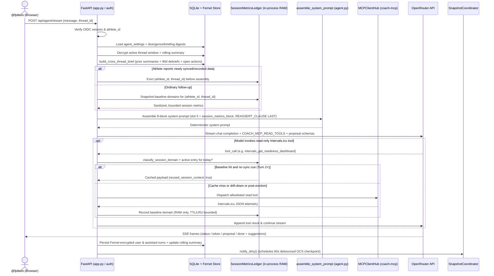
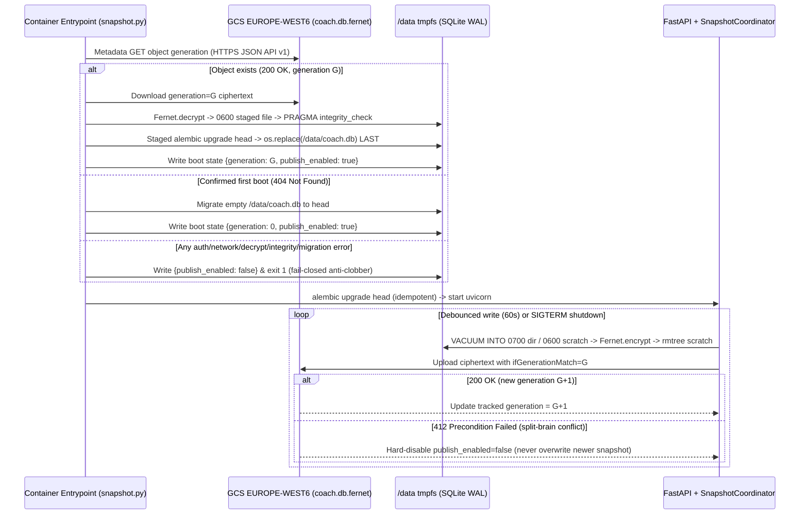
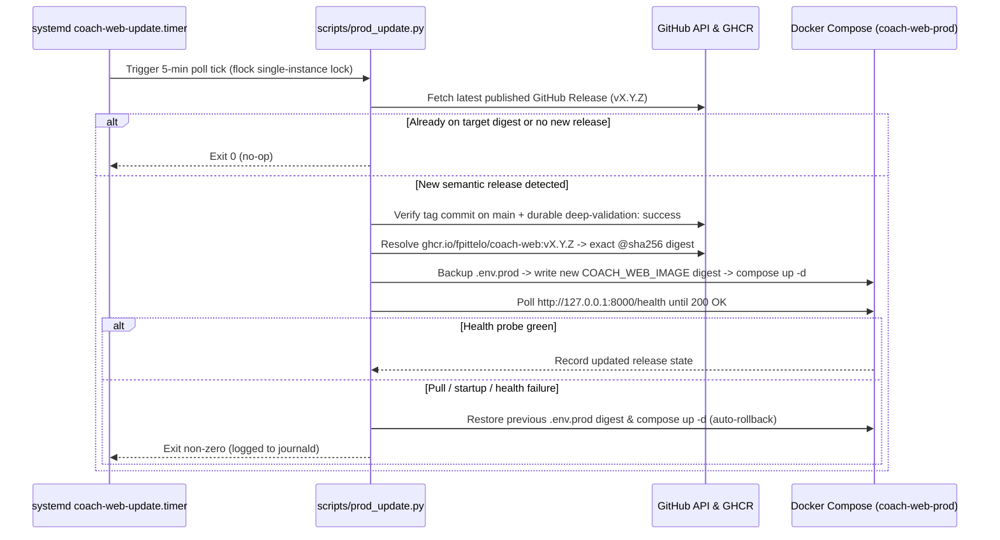

# 2. Runtime & Delivery — Coach Web

**Status:** active (consolidated #369)

---

## 1. Runtime View

### 1.1 Scenario: Agent Chat Turn & 8-Block Prompt Assembly Seam

- **Trigger:** Authenticated athlete submits a chat message (`POST /api/agent/stream` with `{message, thread_id?}`).
- **Preconditions:** Request passed Cloud Run IAP + in-app `AuthMiddleware` (`AUTH_WHITELIST_EMAILS`); `/data/coach.db` is migrated to `head`.

- **Postconditions & Failure Modes:**
  - Every untrusted block (`orientation`, `standing_preferences`, `session_metrics_block`, `memory_block`, `cross_thread_brief`) is sanitized on read and enclosed in `| `-prefixed data fences; `REASSERT_CLAUSE` is structurally **LAST** and names every such block ([MADR-0026](../../adr/0026-admin-orientation-and-agent-settings-prompt-precedence-and-sanitizer-contract.md), [MADR-0032](../../adr/0032-durable-longitudinal-memory-snapshot-store.md) C7/C8, [MADR-0025](../../adr/0025-conversation-memory-model-retention-and-injection-contract.md) Amendment 0002 §1).
  - The intra-session `session_metrics_block` (slot 5) carries only baseline telemetry already fetched in the active `(athlete_id, thread_id)` conversation; a Turn 2+ duplicate baseline read is short-circuited **before** `hub.execute_tool` (zero MCP calls, zero `IcuReadBudget` burn) and returns the cached payload stamped `reused_session_context: true`. The ledger is strictly in-process RAM (MADR-0008 C5), evicted on reset, purge and athlete-reported sync cues.
  - Context/brief store failures degrade **fail-open** (returning core prompt without user data and logging the exception class name only — zero content leakage). With no conversation thread (C7 persistence degrade) the ledger is bypassed entirely and the turn runs statelessly.
  - Unapproved write tools are absent from model tool schemas and refused fail-closed at dispatch; Intervals.icu calendar writes occur exclusively when the athlete clicks **Approve** (`POST /api/plan/approve`).

---

### 1.2 Scenario: Cloud Run Cold-Start Snapshot Rehydration, Checkpoint & Purge ([MADR-0032](../../adr/0032-durable-longitudinal-memory-snapshot-store.md))

- **Trigger:** Cloud Run spins up a new instance from `minScale=0` (`Dockerfile` entrypoint `python -m coach_web.snapshot boot-restore && alembic upgrade head && uvicorn ...`), commits SQLite mutations during traffic, or executes `POST /api/conversation/purge`.
- **Preconditions:** `COACH_SNAPSHOT_BUCKET=coach-web-509209-snapshots` is configured (when empty in local Compose lanes, `boot-restore` and `SnapshotCoordinator` are pure no-ops).

- **Synchronous Purge Guarantee (`C5`):** `POST /api/conversation/purge` commits the scoped SQLite deletion and awaits an immediate `publish_now()` overwrite before returning `200`; if snapshot publication fails or is disabled, the endpoint returns a static redacted `503` so erase confirmation is never reported ahead of durable cloud overwrite.

---

### 1.3 Scenario: Local Prod Release-Verified Auto-Update Tick & Rollback ([MADR-0024](../../adr/0024-always-on-prod-lane-release-verified-auto-update.md))

- **Trigger:** Workstation `systemd` user timer `coach-web-update.timer` fires every 5 minutes, invoking oneshot `coach-web-update.service` (`scripts/prod_update.py`).
- **Preconditions:** Local `prod` stack (`compose.yaml` + `compose.prod.yml`, `127.0.0.1:8000`) is managed by `coach-web.service` with a digest-pinned `COACH_WEB_IMAGE` in `.env.prod`.

- **Cloud Run Rollback Path:** Every `cloud-run-deploy.yaml` run records the pre-deploy `latestReadyRevisionName` (`coach-web-NNNNN-xxx`); rollback is a single traffic shift (`gcloud run services update-traffic coach-web --to-revisions=<prev>=100`) or `git revert` on `main`.

---

## 2. Deployment View

### 2.1 Production Topology — GCP Cloud Run (`coach-web-509209`, `europe-west6`)

Governed by [MADR-0027](../../adr/0027-cloud-run-production-operating-model.md) (Amendments 0001–0005), [MADR-0031](../../adr/0031-public-landing-surface-with-iap-unchanged.md), and [MADR-0032](../../adr/0032-durable-longitudinal-memory-snapshot-store.md), deployed exclusively via the approval-gated keyless WIF workflow `.github/workflows/cloud-run-deploy.yaml` (`gcp-cloud-run` GitHub Environment):

| Node / Resource | Hosted Artifacts & Scaling | Identity & Access Posture |
| :--- | :--- | :--- |
| **Cloud Run Service: `coach-web`** (`europe-west6`) | 3-container pod (`coach-web` `:8080`, `coach-mcp` `:8000`, `github-mcp` `:8001`) + 256 MiB in-memory `/data` `emptyDir`; `minScale=0`, `maxScale=1`, `timeoutSeconds=3600`, `@sha256` digest-pinned GHCR images. | Runtime SA `coach-web-runtime@` holds **zero** project roles, 6 per-secret `secretmanager.secretAccessor` bindings, and bucket-scoped `coachWebSnapshotObjectActor`. Direct-on-service IAP enabled; `roles/run.invoker` == `{IAP service agent}` only. |
| **Cloud Run Service: `coach-web-landing`** (`europe-west6`) | Single shell-free distroless container (`gcr.io/distroless/static-debian12:nonroot`, UID `65532`, `landing/server.go`); `minScale=0`, `maxScale=2`, `timeoutSeconds=10`, `128Mi`, zero env vars, `@sha256` digest-pinned. | Dedicated zero-role SA `coach-web-landing@` (zero project roles, zero SA keys). Public static entry: `roles/run.invoker` == `{allUsers}` only, `iap-enabled` absent, constant CTA to canonical console origin. |
| **GCS Bucket: `gs://coach-web-509209-snapshots`** (`EUROPE-WEST6` regional) | Single canonical object `snapshots/coach.db.fernet` (whole-file Fernet ciphertext). | `UBLA=true`, `PAP=enforced`, Versioning (`numNewerVersions=2`, `daysSinceNoncurrentTime=7` Delete rules), 7d Soft Delete (`604800s`); all `legacyBucket*` bindings scrubbed; exact 2 custom-role bindings (`coachWebSnapshotObjectActor`, `coachWebSnapshotBucketReader`). |
| **Deploy Identity: `coach-web-deployer@`** (Keyless GitHub OIDC WIF) | Executes `.github/workflows/cloud-run-deploy.yaml` pre/post-deploy fail-closed gates and `gcloud run services replace`. | Zero project-level `run.admin` or `iap.admin` (both resource-scoped to individual services per Am. 0002 & Am. 0005); project-level read-only `resourcemanager.viewer` + 1-permission custom `coachWebProjectIamViewer`; per-secret metadata-only `secretmanager.viewer`. |

### 2.2 Local Workstation Topology — VIDAR Docker Compose Lanes

Governed by pre-MADR ADR-007 (`03` §5) and [MADR-0024](../../adr/0024-always-on-prod-lane-release-verified-auto-update.md); all host bindings are strictly loopback (`127.0.0.1`), sidecars publish zero host ports, and `COACH_SNAPSHOT_BUCKET` is unset so SQLite persists directly on per-lane named Docker volumes:

| Lane | Compose Files | Host Binding | Image Source | Auth Mode | Purpose |
| :--- | :--- | :--- | :--- | :--- | :--- |
| **`dev`** | `compose.yaml` + `compose.dev.yml` | `127.0.0.1:8100` | Local source build (`target: runtime`) | `AUTH_ENABLED=false` | Local feature development & smoke testing |
| **`qa`** | `compose.yaml` + `compose.qa.yml` | `127.0.0.1:8200` | `ghcr.io/fpittelo/coach-web:qa` | `AUTH_ENABLED=false` | Pre-tag release-candidate validation on `main` |
| **`prod`** | `compose.yaml` + `compose.prod.yml` | `127.0.0.1:8000` | Digest-pinned `vX.Y.Z` (`systemd` auto-updated) | `AUTH_ENABLED=true` (OIDC) | Always-on local workstation cockpit |
